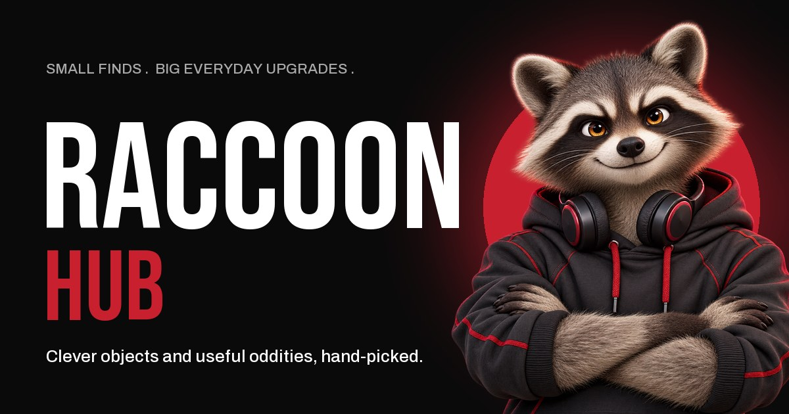

# Araccoon Hub

[](https://github.com/HiteshPatil2610/Araccoon-hub/actions/workflows/ci.yml)
[](LICENSE)
[](LICENSE-ART.md)
[](CONTRIBUTING.md)



A curated Amazon affiliate storefront ("Small finds. Big everyday upgrades.") with a private owner hub for products, analytics and security. The Cine Daily interface (near-black, white and one crimson; Bebas Neue + Archivo) uses real featured catalog records, Bento and Classic layouts, and passkey authentication.

**Source-available, non-commercial:** the code is under the [PolyForm Noncommercial 1.0.0](LICENSE) and the raccoon mascot and artwork under [CC BY-NC 4.0](LICENSE-ART.md). You may read, run, study and modify it for personal, educational and non-profit use; **commercial use needs a licence from the author**. Contributions are welcome: see [CONTRIBUTING.md](CONTRIBUTING.md) and the [code of conduct](CODE_OF_CONDUCT.md).

**Status:** version 0.1.0. Feature-complete and tested locally; first production deployment in progress. Changes are listed in the [changelog](CHANGELOG.md).

**Contents:** [Quick start](#quick-start-for-contributors) · [Local development](#local-development) · [Editing content](#editing-content) · [Pages, search and sharing](#pages-search-and-sharing) · [First deployment](#first-deployment) · [Security design](#security-design-summary) · [Project layout](#project-layout) · [Running your own copy](#running-your-own-copy) · [Contributing](#contributing-and-security) · [License](#license)

See [UI context](context/ui-context.md), [architecture](context/architecture.md), and [verification/progress](context/progress-tracker.md).

| Part | Technology | Free tier |
|---|---|---|
| Website + API | Cloudflare Workers (static React assets + Hono API in one Worker) | 100k API requests/day; static pages unlimited |
| Database | Neon Postgres via Cloudflare Hyperdrive | 1 GB, 100 CU-hours/month |
| Product images | Cloudinary (signed direct uploads, auto re-encoding) | 25 credits/month |
| Rate limits | Upstash Redis (REST) | 500k commands/month |
| Bot check | Cloudflare Turnstile | Unlimited |
| Owner sign-in | Passkeys (WebAuthn) + one-time recovery codes | Built in, no service |

## Quick start for contributors

No accounts or API keys needed. You need Node 24+ and PostgreSQL installed (its `bin` folder on `PATH`, or `PG_BIN` set).

```bash
git clone https://github.com/<your-username>/Araccoon-hub.git
cd Araccoon-hub
npm install
cp .env.example .env
echo "ENVIRONMENT=development" > .env.local
npm run db:local
npm run db:migrate -- --target=dev
npm run db:seed
npm run dev
```

Open http://localhost:5173. Before a pull request, run `npm run typecheck`, `npm test` and `npm run build`. New here? Look for issues labelled [good first issue](https://github.com/HiteshPatil2610/Araccoon-hub/labels/good%20first%20issue).
## Local development

Requires Node 24+ and, for the local database and tests, PostgreSQL binaries on `PATH` (or `PG_BIN`). No paid accounts are needed for local development: copy `.env.example` to `.env`, leave the service keys empty and use the local database.

```bash
npm install
npm run db:local                      # start a local Postgres in .localdb/ (skip if DATABASE_URL_DEV is set)
npm run db:migrate -- --target=dev
npm run db:seed                       # sample products (dev databases only)
npm run dev                           # http://localhost:5173
```

- Secrets live in `.env` (see `.env.example`); local overrides go in `.env.local` (both gitignored).
- `.env.local` should contain `ENVIRONMENT=development`. Optionally add `DEV_LOGIN_TOKEN=<random>` to get a development-only sign-in box on `/admin/login`. The server refuses it unless `ENVIRONMENT=development` (production config ignores the token, and a test checks this).
- Owner hub: `http://localhost:5173/admin`. Passkeys work on `localhost` in modern browsers.

## Editing content

| What | Where | How it reaches the site |
|---|---|---|
| Products | Owner hub → **Products** | Database; live within a minute |
| Short storefront text (hero, story, footer, search title and description) | Owner hub → **Site text** | Database; live within a minute. Reset any field to its original text |
| Articles | Markdown files in [`content/articles/`](content/articles/README.md) | Compiled at build; publish by committing and deploying |

Article rules (front matter, alt text, no direct Amazon links: list product ids instead) are in [content/articles/README.md](content/articles/README.md); the build stops with the file name if something is wrong.

## Pages, search and sharing

The Worker serves `/`, `/articles` and `/articles/<slug>` itself (`worker/routes/pages.ts`). It fills the built `index.html` with the page's title, description, canonical link, Open Graph/Twitter share tags (image: `public/og-image.jpg`, made by `art/og/make_og.py`), JSON-LD, a `<noscript>` text version, and the page's data (site text and products), so the first render needs no API call. Rendered pages are cached at the edge for 60 seconds in production. It also serves `/robots.txt` and `/sitemap.xml`; outside production both pages and robots.txt tell search engines to stay away.

| Command | What it does |
|---|---|
| `npm run dev` | Vite + the Worker in the real `workerd` runtime, pointed at the dev database |
| `npm run typecheck` | Strict TypeScript for client, Worker and tests |
| `npm test` | Unit and integration tests against a throwaway Postgres cluster (never `.env`); visibly skips integration suites if PostgreSQL is unavailable |
| `npm run test:security` | Full suite including adversarial security tests; fails if PostgreSQL integration tests cannot run |
| `npm run build` | Type-check and production build |
| `npm run db:migrate -- --target=dev\|prod` | Apply versioned migrations (you must name the target) |
| `npm run articles` | Compile `content/articles/*.md` (also runs automatically before build, typecheck, test and during dev) |
| `npm run deploy` | Type-check, mandatory security/integration tests, build, `wrangler deploy` |

## First deployment

1. Fill in `.env` (all values from the setup guide) and run `npx wrangler login`.
2. Create the database connection: `npx wrangler hyperdrive create araccoon-hub-db --connection-string="<DATABASE_URL>"` and paste the returned id into `wrangler.jsonc` → `hyperdrive[0].id`.
3. Migrate production: `npm run db:migrate -- --target=prod` (run it again after updates that add migrations, such as the site text table).
4. Upload secrets (one at a time, paste each value when prompted):
   `SESSION_SECRET RECOVERY_CODE_PEPPER OWNER_EMAIL OWNER_SETUP_TOKEN PASSKEY_RP_ID PASSKEY_ORIGIN TURNSTILE_SITE_KEY TURNSTILE_SECRET_KEY CLOUDINARY_CLOUD_NAME CLOUDINARY_API_KEY CLOUDINARY_API_SECRET CLOUDINARY_UPLOAD_PRESET UPSTASH_REDIS_REST_URL UPSTASH_REDIS_REST_TOKEN AMAZON_ASSOCIATE_TAG`
   → `npx wrangler secret put <NAME>`. For production, `PASSKEY_RP_ID` = your host (e.g. `araccoon-hub.<you>.workers.dev`) and `PASSKEY_ORIGIN` = `https://` + that host. Add the same host to the Turnstile widget.
5. `npm run deploy`, open `https://<host>/admin/login` → **First-time setup** → your email + setup token → create your passkey → save the recovery codes. Setup closes permanently after this; then delete the `OWNER_SETUP_TOKEN` secret.
6. Add a second passkey (phone + laptop) under **Settings**.

## Security design (summary)

- **Owners**: passkeys only (phishing-resistant, no passwords). Server-side sessions in an HttpOnly, Secure, SameSite=Strict cookie; only a SHA-256 of the token is stored. Sign-out, sign-out-everywhere and disabling an owner take effect on the next request. First-owner setup needs `OWNER_EMAIL` + `OWNER_SETUP_TOKEN` and closes after the first passkey. Further owners join by single-use 48-hour invites. Recovery codes are one-time, stored as keyed HMACs, and a recovery session can only add a new passkey.
- **CSRF**: SameSite=Strict cookies plus an exact `Origin` check on every state-changing API call.
- **Trusted links**: product links must be `https` on `AFFILIATE_ALLOWED_HOSTS` (exact host or subdomain; short-link hosts exact). They're re-checked on every redirect, and visitors never see raw affiliate URLs. Per-store Associates tags are added automatically.
- **Validation**: shared zod schemas (unknown fields rejected), parameterized SQL, CHECK constraints in the database.
- **Abuse limits**: Upstash-backed per-IP/per-account/per-owner rate limits (sensitive routes fail closed if Redis is down), Turnstile on sign-in and recovery, 100 KB request bodies.
- **Analytics privacy**: visitors are anonymous. Visitor-days use a keyed daily hash, so no IP is stored. Owner test clicks are excluded. Clicks are kept for 90 days (daily cron).
- **Audit**: append-only activity log of every sign-in and change (owner ids only, no secrets).
- **Headers**: strict CSP (no inline scripts), HSTS, `frame-ancestors 'none'`, nosniff — see `public/_headers`.

## Project layout

```
shared/     types, zod schemas, URL policy, CSV (used by client and server)
worker/     Hono API: routes/, auth/, repo/, db/ (migrations), lib/ (rate limit, Turnstile, Cloudinary, crypto)
src/        React app: pages/ (storefront), admin/ (owner hub), components/, lib/
scripts/    dev, local database, migrations, seed, article compiler
content/    articles as Markdown (content/articles/)
tests/      unit + integration (virtual passkey authenticator, throwaway Postgres)
```

As an Amazon Associate I earn from qualifying purchases.

## UI verification preview

`npm run build` uses Vite's runner config loader to avoid native plugin bundling issues on Windows. After building, `node scripts/ui-fixture-preview.mjs` serves **isolated QA fixtures** at `http://127.0.0.1:5174`. This test server has no database, does not upload to Cloudinary, and deliberately fails product writes. Its product labels and zero activity are test data, never real catalog or business records. It is not part of the Worker deployment. See the progress tracker for screenshot coverage and remaining manual checks.

## Running your own copy

You may fork and run this project for **personal, educational or non-profit** purposes, for example to learn from it or try it out.

- **An affiliate store that earns money is commercial use.** It needs a commercial licence from the author first (open an issue titled "Commercial licence").
- Use **your own** service accounts, and replace the Araccoon name and raccoon mascot with your own branding (see [LICENSE-ART.md](LICENSE-ART.md)).
- If you are licensed to run a store, use your own Amazon Associates tag and keep the Associates disclosure, as Amazon's rules require.

## Contributing and security

- How to contribute: [CONTRIBUTING.md](CONTRIBUTING.md)
- Community rules: [CODE_OF_CONDUCT.md](CODE_OF_CONDUCT.md)
- Reporting a vulnerability: [SECURITY.md](SECURITY.md) (privately, never in a public issue)
- What changed: [CHANGELOG.md](CHANGELOG.md)
- Maintainer's public-repo checklist: [docs/OPEN_SOURCE_CHECKLIST.md](docs/OPEN_SOURCE_CHECKLIST.md)

## License

- **Code:** [PolyForm Noncommercial 1.0.0](LICENSE) © 2026 Hitesh Patil. Commercial use requires permission: open an issue titled "Commercial licence" or contact [@HiteshPatil2610](https://github.com/HiteshPatil2610).
- **Versions published before 4 November 2026** (up to commit `75551df`) were released under MIT and stay MIT for anyone who copied them then.
- **Raccoon mascot and artwork:** [CC BY-NC 4.0](LICENSE-ART.md) © 2026 Hitesh Patil
