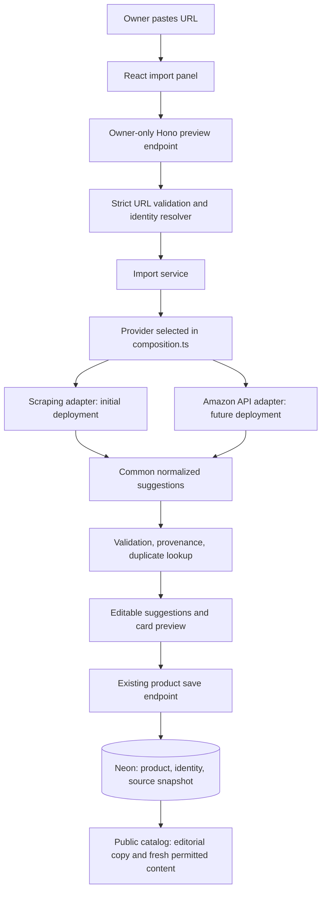

# Product URL import: scraping now, official API later

Date: 6 October 2026
Status: implementation proposal; no importer or API adapter has been implemented by this document.

Implementation update: after the initial owner-content release, the user requested automatic product details without manual entry and confirmed no API access yet. The selected provider is now a bounded Amazon-page extractor supporting link-only fetch, images, descriptions, features, and specifications. See [implemented product URL assistance](product-url-assistance.md) for current behavior. The proposal below is historical; the official API boundary remains dormant.

## 1. Decision and scope

Build one product import feature with two interchangeable backend providers:

1. Initially select the scraping provider through an explicit code import.
2. Prepare the official Amazon API adapter, shared contracts, test fixtures, and migration runbook in the repository.
3. When access becomes available, configure server credentials, complete live verification, change the selected provider in code, and deploy.
4. Remove the scraping implementation and its dependencies after cutover.

Adding credentials does not switch providers. There is no automatic selection, no admin provider toggle, and no API-to-scraping fallback. After cutover, API errors return a useful error and leave manual editing available.

Goal: paste a product URL, retrieve available product facts and image candidates, review suggestions against a card preview, and save a draft. Import does not publish a product.

Initial scope: Amazon.in and Amazon.com product links plus the short-link hosts explicitly supported by the current server configuration. Start with Amazon.in fixtures because it is the likely primary marketplace, then verify Amazon.com independently. Prices, public ratings, bulk crawling, AI writing, and automatic stock tracking are outside the first release.

### Important feasibility boundary

An affiliate tracking ID is not permission to scrape or republish product content. Amazon's US program license restricts data extraction tools. Verify applicable marketplace terms and any necessary authorization before deploying the scraping provider. Public accessibility alone does not establish reuse rights. This architecture describes a bounded extractor; it does not guarantee that Amazon will permit or serve its requests. If access is refused, use manual entry and authorized images; do not bypass CAPTCHA, login, or access controls.

Official API access is also more than pasting an arbitrary key: use the credential set, authentication flow, marketplace configuration, and partner tag required by the current Amazon documentation. Creators API is the current integration target to evaluate. Exact credentials and endpoints must be verified when implementing the adapter and again at activation.

## 2. Existing project integration

| Existing area | Current behavior | Planned change |
| --- | --- | --- |
| `src/admin/ProductEditor.tsx` | Manual form, upload, validation, default published status | Import panel, selective merge, live preview, imported draft default |
| `src/lib/api.ts` | Central client, 15-second default timeout | Typed preview call, cancellation, optional job polling later |
| `shared/schemas.ts` | Strict product schemas; title 200 characters and description 2000 | Separate import request/result schemas; preserve authoritative product validation |
| `shared/types.ts` | Public and owner product types; five curated categories | Editorial description fields and provenance references where required |
| `shared/urlPolicy.ts` | Trusted affiliate destination policy | Reuse parsing helpers; add stricter server-fetch policy separately |
| `worker/routes/adminProducts.ts` | Owner-only writes, rate limits, audit, Cloudinary signatures | Save validated import selections through normal product writes |
| `worker/app.ts` | Dependency injection, CSRF, private response headers | Inject product importer and outbound transport for tests |
| `worker/server.ts` | Hono route composition | Register dedicated owner import routes |
| `worker/repo/products.ts` | Product persistence and public mapping | Identity lookup, provenance, fresh source-content resolution |
| `worker/db/migrations.ts` | Append-only versioned migrations | Append identity/snapshot schema; never edit applied migrations |
| `worker/config.ts`, `worker/index.ts` | Server config and Worker construction | Construct selected provider and its required services |
| `worker/maintenance.ts` | Scheduled maintenance | Provider-content expiry and refresh when required |
| `src/components/ProductCard.tsx` | Two-line title and description | Use approved short description; longer copy in Quick view |

Keep existing passkey authentication, CSRF middleware, affiliate tracking rules, and product-save validation. Do not introduce a separate storefront or a second database.

## 3. Architecture



Only one provider is constructed in each deployment. The two arrows from the selection node represent alternative builds, not concurrent requests or fallback.

### Proposed module layout

```text
shared/productImport.ts
worker/routes/adminProductImports.ts
worker/lib/productImport/
  contracts.ts
  composition.ts
  service.ts
  resolveProductUrl.ts
  fetchPolicy.ts
  normalize.ts
  errors.ts
  providers/
    scraping/
      provider.ts
      extractAmazon.ts
      selectors.ts
    amazonApi/
      provider.ts
      client.ts
      auth.ts
      mapResponse.ts
      README.md
worker/repo/productSources.ts
src/admin/ProductImportPanel.tsx
tests/fixtures/product-import/
tests/unit/product-import.test.ts
tests/integration/product-import.test.ts
```

The API folder stays in normal version-controlled source. Do not hide future code in a zip, commented block, or copied text document. Build it against mocked responses until credentials become available. If authentication or response schemas cannot be verified, mark those pieces as incomplete and return `PROVIDER_NOT_READY`; never pretend the adapter is production-ready.

### Common provider contract

Illustrative TypeScript; final types belong in shared/server modules as appropriate:

```ts
type ProviderId = 'scraping' | 'amazon-api';

interface ProductIdentity {
  marketplace: 'amazon.in' | 'amazon.com';
  asin: string; // validated 10-character product identifier
  canonicalUrl: string;
}

interface SourceValue<T> {
  value: T;
  evidence: 'catalog-api' | 'json-ld' | 'page-selector' | 'metadata';
  observedAt: string;
}

interface ExtractedProduct {
  identity: ProductIdentity;
  provider: ProviderId;
  title?: SourceValue<string>;
  description?: SourceValue<string>;
  features: SourceValue<string>[];
  brand?: SourceValue<string>;
  model?: SourceValue<string>;
  variant?: SourceValue<string>;
  images: Array<{
    url: string;
    source: ProviderId;
    reuse: 'unverified' | 'authorized' | 'provider-reference';
  }>;
  fetchedAt: string;
  expiresAt: string | null;
  warnings: string[];
}

interface ProductImportProvider {
  readonly id: ProviderId;
  extract(identity: ProductIdentity, signal: AbortSignal): Promise<ExtractedProduct>;
}
```

Absent fields remain absent. Never fill missing ratings with five stars or invent missing specifications. Validation strips markup, bounds strings/arrays, validates image references, and reports conflicting identity or variant evidence.

### Manual provider selection

Initial `composition.ts`:

```ts
import { createScrapingProvider } from './providers/scraping/provider';

export const createSelectedProvider = createScrapingProvider;
```

Future `composition.ts`:

```ts
import { createAmazonApiProvider } from './providers/amazonApi/provider';

export const createSelectedProvider = createAmazonApiProvider;
```

Both factories receive the same dependency object; API configuration is optional in that object but mandatory to construct the API provider. Provider-specific validation runs for the selected factory only. Credentials are never used to infer which provider to choose. Missing API credentials after cutover fail import configuration explicitly; manual product editing should remain available.

## 4. Shared URL and identity workflow

1. Validate input length and normalize supported HTTPS URLs.
2. Accept only exact approved fetch hosts. The current affiliate policy allows some subdomains; that is insufficient by itself for outbound fetching.
3. For short links, use manual redirects, maximum three hops, and validate every destination before fetching. Refuse unexpected redirect hosts.
4. Extract ASIN from supported `/dp/ASIN` and `/gp/product/ASIN` paths; implement other patterns only with fixtures.
5. Establish marketplace from the resolved destination, not from assumptions about a short-link hostname.
6. Preserve the affiliate URL separately from the canonical lookup URL. Never discard existing tag/sub-ID overrides during import.
7. Reject search pages and ambiguous variation pages, or require an exact product link.
8. Query existing identities by `(marketplace, asin)` and offer to open the existing product.

API mode may still need a bounded request to resolve a short link. That is URL resolution, not page-content scraping. Offer full product URLs as a fallback if redirect resolution is blocked. After cutover there must be no product-page HTML extraction requests.

## 5. Scraping provider workflow

### Execution strategy

Run extraction on the backend. Browser-side cross-origin fetches are unreliable and cannot enforce the required outbound policy.

Start with a bounded Worker `fetch` and streaming HTML parser. Cloudflare `HTMLRewriter` is a candidate; collect limited relevant elements and structured-data scripts rather than building an unbounded DOM. Verify extraction behavior inside workerd. A parser requiring unsupported Node APIs should not be added without runtime verification.

Do not add a headless browser to the first version. If a permitted page requires rendering, consider a separate Cloudflare Browser Run adapter later with strict navigation/subrequest controls and a durable queue. Rendering does not grant permission or guarantee access.

### Extraction sequence

1. Fetch canonical product page with a descriptive crawler identity where required.
2. Enforce total deadline, HTML content type, and streamed byte limit before parsing.
3. Detect access-denied, CAPTCHA, consent/interstitial, and login pages.
4. Parse matching `Product` JSON-LD, including arrays and `@graph`.
5. Extract bounded product-specific title/features/model/variant using versioned selectors.
6. Use Open Graph only when it matches product identity; generic site metadata is insufficient.
7. Collect product-image candidates while rejecting recommendations, tracking pixels, sprites, and unrelated variants.
8. Normalize text and return a partial preview with missing-field warnings.

Proposed starting budgets: 8-second total network/extraction deadline, 1.5 MB decoded HTML, three redirect hops, ten image candidates, ten feature bullets, five preview attempts per owner per minute. These are application defaults to tune with actual fixtures and Worker CPU limits, not vendor guarantees.

Handle 403/CAPTCHA as `SOURCE_BLOCKED` and stop. Do not implement rotating residential proxies, CAPTCHA solving, account-cookie scraping, or repeated retries to defeat a refusal. Retry transient failures at most once within the deadline; respect `Retry-After`.

### Limits to communicate

Scraping can fail or extract incomplete data because page layout, geography, delivery location, and variants change. It should assist data entry, not promise perfect imports. Owner approval does not resolve content licensing. Image candidates with unverified reuse rights are not automatically publishable or uploaded to Cloudinary.

## 6. Future API provider workflow

1. Resolve product identity through the shared URL layer.
2. Select the supported marketplace and its configured Associates tag.
3. Acquire/use credentials through the officially documented authentication mechanism.
4. Request item details by ASIN; request supported resources only.
5. Map response fields into the same `ExtractedProduct` contract.
6. Attach source timestamps and provider expiry rules.
7. Return suggestions through the same preview UI.

Implement `client.ts` as the only module aware of API endpoints and wire schemas. Put authentication in `auth.ts`; mapping in `mapResponse.ts`. This keeps future API changes local.

Secrets live in Worker secrets and gitignored local environment files. Names in the eventual `.env.example` must match the verified credential scheme; do not invent a single `AMAZON_API_KEY` setting and assume it is sufficient. Document marketplace, partner tags, scopes/resources, token lifetime if applicable, and quota behavior in the adapter README.

Cache tokens only as permitted, mask credentials in logs, and never send them to React. Handle invalid credentials, lost eligibility, throttling, missing items, and unsupported marketplaces explicitly. None of these errors activates scraping.

What can be prepared now: contract, module boundaries, provider selection, mocks, response mapping from documented examples, error handling, lifecycle model, and runbook. What remains unverified until access: live authentication, granted fields, actual marketplace availability, account quotas, and end-to-end refresh behavior.

## 7. Preview API and owner interface

Initial endpoint:

```http
POST /api/admin/product-imports/preview
Content-Type: application/json

{"url":"https://www.amazon.in/dp/EXAMPLE123"}
```

The example identifier is illustrative, not a real product.

Success returns a server-owned preview ID, identity, provider, suggestions, warnings, duplicate product ID if present, and expiry. Source values remain server-controlled. A partial result is a successful preview with warnings; an unidentified product is an error.

Apply `requireOwner`, existing exact-origin CSRF checks, strict Zod body parsing, no-store headers, and a dedicated import rate limit. Register the dedicated route in `worker/server.ts`.

Store previews only for a short review window, such as 15 minutes, bounded by any earlier source expiry. On product save, submit preview ID plus selected fields; verify ownership, expiry, identity, and server-held values. Do not accept a client assertion that an image or source is authorized. Manual editorial edits are validated normally and tracked separately.

| Error code | HTTP | Owner action |
| --- | --- | --- |
| `INVALID_PRODUCT_URL` | 400 | Paste a supported product link |
| `SOURCE_BLOCKED` | 422 | Enter details manually |
| `PRODUCT_UNIDENTIFIED` | 422 | Paste exact variant/product URL |
| `PREVIEW_EXPIRED` | 409 | Import again |
| `RATE_LIMITED` | 429 | Wait for retry time |
| `SOURCE_TIMEOUT` | 504 | Retry later or edit manually |
| `PROVIDER_NOT_READY` | 503 | Configure/finish selected provider |
| `PROVIDER_AUTH_FAILED` | 503 | Owner checks server credentials/access |

Do not expose provider secrets or raw upstream responses in errors.

UI states: idle, importing, partial/ready, applying, failed. Cancel a request when URL changes or dialog closes. Track request identity so late results cannot replace newer input. Use accessible status announcements and a manual Retry button.

Offer field checkboxes and image selection. Initially fill empty fields only; explicitly show replacements for nonempty fields. Category suggestions use only the existing `CATEGORIES`. Keep affiliate overrides, badge, featured flag, and sort order owner-controlled. Change imported new products to draft in both the UI and server import-save behavior; the existing schema currently defaults to published.

## 8. Data model and content quality

Append a migration with these conceptual records:

| Record | Fields | Lifetime |
| --- | --- | --- |
| Product identity | product ID, marketplace, ASIN, canonical URL | Durable; unique marketplace + ASIN for imported products |
| Source snapshot | provider, normalized permitted payload, fetched/expiry timestamps, extraction version | Provider-bounded; purge expired payloads |
| Preview | owner ID, identity, server suggestions, expiry | Short-lived, never public |
| Editorial fields | approved title, short description, detailed description, category, locked fields | Durable only where content rights permit |
| Provenance | field, source kind, observation/review time, image-use classification | Durable metadata; no indefinite copies of expired provider text |

Existing manual products remain compatible; they have no imported identity until explicitly attached. Do not rewrite them during migration. Before adding uniqueness, reconcile duplicates. Legitimate alternate editorial layouts should share one identity record if later supported.

Use existing `description` as card copy initially. Add `detailsDescription` and feature fields only if Quick view is updated to use them. Suggested editorial targets: concise title around 40-80 characters, card description around 120-220 characters, three to five relevant feature bullets. These are soft targets; the existing strict limits remain authoritative.

Separate independently authored editorial content from provider-managed content. Renaming, reviewing, or lightly rewriting imported content does not automatically make it independently owned or exempt from provider rules. Do not retain original source payloads forever as an audit trail.

AI writing is optional later. Establish permitted input use first; then provide bounded facts, require structured output, and reject invented claims. Do not send raw page HTML to a model or interpret external text as instructions. First release can use deterministic cleanup and owner writing.

## 9. Images, refresh, and public display

Cloudinary remains the store for owner-owned/authorized uploads. Importing a URL does not establish permission to copy the image. API image references remain provider-managed; do not download/re-upload them automatically.

The US API-content license includes a 24-hour limit for image-link and other content caching and prohibits storing the images themselves. Implement marketplace/provider-specific rules rather than a universal permanent snapshot. Verify current applicable rules before activation.

Check expiry at public mapping time, not only during scheduled refresh. Refresh before expiry using bounded batches and provider quotas. If refresh fails, omit expired provider content and use a permitted editorial/authorized-image fallback, or hide incomplete cards. Prevent expired content appearing through catalog search, cached API responses, CSV exports, previews, and Quick view. Apply required provider attribution/disclaimers to public display.

Keep immutable frontend asset caching; separately bound catalog-response caching by the earliest source expiry. Purge old source payloads and sensitive preview data. Existing product images with unknown provenance need a migration review; do not silently relabel them as authorized.

## 10. Security and operations

- Fetch hosts and paths are narrower than affiliate destination hosts; validate hostname parsing, ports, credentials, and every redirect.
- Deny private, loopback, link-local, and metadata destinations. Do not trust a one-time DNS lookup against rebinding; use controlled destinations/egress and validate actual network behavior where possible.
- Rendered extraction, if added, must restrict subresources and navigation as well as the initial URL.
- Enforce streamed byte limits and decoded-size limits; avoid unbounded JSON-LD parsing and arrays.
- Use text rendering; never insert extracted HTML into React.
- Treat remote image downloads as a separate restricted fetch operation; no arbitrary server-side image proxy.
- Store preview ownership and idempotency references; avoid duplicate products on repeated saves.
- Log provider, marketplace, result code, duration, field completeness, and extraction version. Strip affiliate query strings, tokens, raw HTML, and credentials.
- Record import/apply audit events with existing owner audit infrastructure.
- Report success rate, blocked rate, partial-result rate, latency, and provider quota failures. Small owner-operated scale needs no separate analytics service initially.

Required services initially: existing Worker, Neon/Hyperdrive, Upstash limits, and Cloudinary for authorized uploads. No scraping service or AI subscription is mandatory. Browser Run and Queues are optional later; evaluate their current cost and account limits before adding them.

## 11. Implementation sequence and verification

### Phase A: common foundation

Add shared schemas, import service, URL identity resolver, preview endpoint, source records, and editor preview. Implement the provider interface with a fake provider for development/tests. Verify that importing never publishes, overwrites edited fields, or changes affiliate tracking.

### Phase B: bounded scraping provider

Complete applicable source permission/terms checks. Build parsers from synthetic fixtures or fixtures whose storage/use is permitted. Cover JSON-LD, selectors, variants, short redirects, block pages, and partial extraction. Validate in workerd and perform a small authorized smoke test. Do not promise extraction success based on fixtures alone.

### Phase C: dormant API adapter

Build API client boundaries, auth module according to current docs, mapper, mock responses, contract tests, and adapter README. Keep the production composition selecting scraping. Mark live-dependent checks pending in the README.

### Phase D: API cutover

Follow the runbook below, verify content expiry and public display, deploy API-only code, and remove scraping.

Required test cases:

- Identical public preview shape across providers; absent fields stay absent.
- Allowed full URLs, supported short links, off-host redirects, lookalikes, credentials, ports, private-network URLs, excessive redirects, and timeouts.
- Correct marketplace, ASIN, variant, category, duplicate detection, and preserved affiliate overrides.
- CAPTCHA is rejected; recommendation images and unrelated JSON-LD are not imported.
- Large/truncated HTML and invalid structured data cannot exhaust resources.
- Owner authentication, CSRF, rate limiting, preview ownership/expiry, and malicious text.
- Late preview responses and manual-edit preservation in the editor.
- API auth failure, throttling, unavailable item, refresh failure, expired snapshots, and zero scraping calls in API mode.
- Existing manual catalog and image cleanup/reference counting remain correct.

Run `npm run typecheck`, `npm run build`, relevant unit/integration tests, and mandatory `npm run test:security` before shipping. UI fixtures alone do not verify network extraction or database writes.

## 12. Manual migration runbook

1. Obtain official access for required marketplaces and verify current authentication, quotas, resources, and content-use rules.
2. Update the dormant adapter for the current API contract. Configure credentials as Worker secrets and local gitignored values; keep the existing Associates tag mapping.
3. Run API smoke tests in development against a few known ASINs. Verify title, image references, variant identity, missing-field behavior, and expiry.
4. Stop admitting new scraping jobs if asynchronous processing was added; drain/cancel existing jobs and previews. For the initial synchronous flow, expire outstanding scraping previews before cutover.
5. Change the two lines in `composition.ts` to import/export the API factory. Adding secrets alone makes no behavior change.
6. Delete scraping provider files, selectors, scraping-only fixtures, dependencies, bindings, secrets, and any queued scraping task handlers. Keep shared URL resolution and API contract tests.
7. Review existing imported content provenance. Replace unverified images/text with permitted editorial content or new API-managed content. Do not convert a scraped snapshot into an API snapshot merely by changing its provider label.
8. Preserve product IDs, affiliate settings, owner edits, and analytics references. Refetch source content by existing marketplace/ASIN instead of recreating products.
9. Run checks and a test transport that fails on any product-page HTML request in API mode. Separately allow bounded short-link resolution where supported.
10. Deploy and verify preview, draft saving, public content expiry, and a simulated API outage. Inspect the built dependency graph and egress logs to confirm scraping is absent.
11. Keep provider implementation history in Git. If API activation fails, revert to a manual-import-disabled deployment; do not automatically reactivate scraping. Any deliberate scraping redeployment requires a separate explicit decision.

Expected cutover code work is small if the contract remains stable, but live authentication and legacy-content review cannot be eliminated by architecture. The unchanged parts should be editor workflow, preview endpoint, normalization, identity storage, and product-save validation.

## 13. Definition of done

Initial release: a supported permitted URL can return accurate partial suggestions, show provenance and duplicate warnings, preserve manual work, and save a reviewed draft; blocked pages fail clearly and manual entry works.

API preparation: the future provider is present in source with documented setup, mocked contract coverage, explicit pending live checks, and no runtime activation based on secrets.

API migration: only the API provider is selected and shipped; scraping code/dependencies/jobs are removed; no API failure triggers HTML extraction; existing product IDs and owner edits survive; source-content lifetime and image handling follow applicable rules.

## 14. Reference sources and revalidation

Reviewed 6 October 2026. Provider details can change; consult primary docs at implementation and activation.

- [Amazon Creators API introduction and operations](https://affiliate-program.amazon.com/creatorsapi/docs/en-us/introduction)
- [Amazon US Associates program policies and content-use license](https://affiliate-program.amazon.com/help/operating/policies)
- [Amazon India Associates policies](https://affiliate-program.amazon.in/help/operating/policies) — verify full applicable content in your account; retrieval did not establish all marketplace-specific terms.
- [Cloudflare Worker limits](https://developers.cloudflare.com/workers/platform/limits/)
- [Cloudflare Browser Run FAQ and queue integration](https://developers.cloudflare.com/browser-run/faq/)

The endpoint names, file layout, defaults, and database additions above are proposed project design decisions, not existing implementation or promised vendor behavior.
